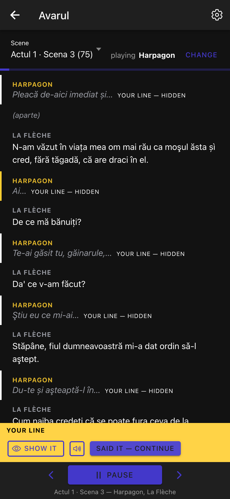

# Osvald — cross-platform rehearsal app for actors

Upload a PDF of a play. Osvald reads it, splits it into scenes, characters and
lines, and then runs the scene with you: it reads every other role aloud and
stops dead on yours, showing only the first few words as a cue.

> **Status: working prototype.** The whole loop runs end to end — upload → text
> extraction (text layer, OCR for scans) → parsing → rehearsal with speech.
> Accounts are real (Argon2id + JWT). The known gaps are listed in §6.



---

## 1. Architecture

```
osvald/
├── packages/
│   ├── shared/       @osvald/shared      Zod schemas + inferred TS types (single source of truth)
│   ├── backend/      @osvald/backend     Fastify + Drizzle (Postgres) + BullMQ (Redis) + JWT
│   ├── frontend/     @osvald/frontend    Vue 3 + Pinia + Ionic Vue + Capacitor (iOS/Android)
│   └── ocr-service/  (Python)            FastAPI + PaddleOCR skeleton — NOT part of the pnpm workspace
├── docker-compose.yml                    postgres, redis, backend, ocr-service (+ optional worker)
├── turbo.json, eslint.config.mjs, tsconfig.base.json
└── pnpm-workspace.yaml
```

Everything that crosses the HTTP boundary is described **once** in
`packages/shared` and validated on both sides: Fastify uses
`fastify-type-provider-zod`, and the frontend's API client parses every response
with the same schema.

### How a script flows through the system

```
PDF upload ──► POST /scripts/upload ──► store file + scripts row (status: uploaded)
                                     └─► enqueue job on the `script-parsing` queue
                                                       │
                         worker process (BullMQ) ──────┘
                           status: parsing
                              │
                              ├─ POST /ocr/pdf  ──► text layer per page (pypdfium2)
                              │                    └─ no text layer? render + PaddleOCR
                              │
                              ├─ parse  ──► cleanup (headers, folios, footnotes, hyphenation)
                              │             └─ scenes / characters / lines
                              │
                              └─ one transaction ──► status: parsed  (or failed + parse_error)
```

The frontend polls the script while it is `uploaded`/`parsing`, so the detail
page shows progress and then fills itself in.

### How a rehearsal runs

The actor picks a role. From then on the engine walks the scene's lines:

| Line belongs to   | What happens                                                                                      |
| ----------------- | ------------------------------------------------------------------------------------------------- |
| another character | spoken aloud, with that character's own voice, then auto-advance                                  |
| a stage direction | shown in italic, skipped silently (toggleable)                                                    |
| **the actor**     | everything stops; only a cue is shown until they ask to see it, and the scene waits for their tap |

Speech goes through a `SpeechService` interface with a Web Speech API
implementation; the native (Capacitor) one is still a stub.

---

## 2. Prerequisites

| Tool    | Version used     | Notes                                                |
| ------- | ---------------- | ---------------------------------------------------- |
| Node.js | 24.x             | `.nvmrc` pins it                                     |
| pnpm    | 12.5.1           | `npm i -g pnpm@12.5.1` (see the corepack note below) |
| Docker  | 28.x             | Compose v2 (`docker compose …`)                      |
| Python  | 3.12 (container) | only needed to run the OCR service outside Docker    |

> **corepack note:** the corepack bundled with Node 24 (0.34) cannot launch
> pnpm 12's native CLI, so install pnpm globally with npm instead. The
> `packageManager` field still records the expected version.

---

## 3. Quick start

```bash
pnpm install                    # install the whole workspace
cp .env.example .env            # optional: override compose settings

pnpm docker:up                  # postgres (5433), redis (6379), backend (3000), ocr-service (8001)

cp packages/backend/.env.example packages/backend/.env
cp packages/frontend/.env.example packages/frontend/.env
pnpm db:migrate                 # create the tables
pnpm db:seed                    # import codPython/avarul.txt → 3 ready-to-rehearse plays

pnpm dev:worker                 # the parsing worker (needed for uploads)
pnpm dev:frontend               # http://localhost:5173
```

Sign in with **`demo@osvald.app` / `osvald-demo-2026`** (created by `db:seed`),
or use the _Use the demo account_ button on the sign-in screen.

> **Port 3000 may be taken.** If the backend exits with `EADDRINUSE`, set `PORT`
> in `packages/backend/.env` and `VITE_API_BASE_URL` in
> `packages/frontend/.env` to the same new port.

`GET /health` is the wiring check — open _Show backend status_ on the library
screen. With the Compose stack running you should see `status: "ok"` and
`database/redis/ocrService: "up"`.

### Trying the upload path

`samples/avarul-excerpt.pdf` is a small digital PDF that exercises the whole
pipeline in a second or two. `codPython/avarul.pdf` is a 68 MB scan — larger
than `UPLOAD_MAX_BYTES` and only readable with the OCR build (see §5), which is
exactly why the seed importer exists.

### Host ports

Ports were chosen to avoid clashing with services already listening on this
machine (5432 and 8000 were taken). Override any of them in `.env`:

| Service         | Host | Container |
| --------------- | ---- | --------- |
| Postgres        | 5433 | 5432      |
| Redis           | 6379 | 6379      |
| Backend API     | 3000 | 3000      |
| OCR service     | 8001 | 8000      |
| Vite dev server | 5173 | –         |

---

## 4. Common commands

```bash
# development
pnpm dev                      # turbo: shared (watch) + backend (tsx watch) + frontend (vite)
pnpm dev:backend              # just the API
pnpm dev:frontend             # just the web app
pnpm dev:worker               # BullMQ consumer for the `script-parsing` queue

# quality gates
pnpm build                    # turbo build (shared → backend → frontend)
pnpm typecheck                # tsc / vue-tsc, strict everywhere
pnpm lint                     # ESLint (shared flat config at the root)
pnpm lint:fix
pnpm format                   # Prettier

# database
pnpm db:generate              # drizzle-kit: generate a migration from the schema
pnpm db:migrate               # apply migrations
pnpm db:seed                  # import already-extracted script text (see below)
pnpm db:studio                # browsing UI

# containers
pnpm docker:up                # start the stack
pnpm docker:down              # stop it
pnpm docker:logs              # follow logs
docker compose --profile worker up -d    # adds the queue worker
```

---

## 5. What is implemented

| Area                                                                                 | State                                     |
| ------------------------------------------------------------------------------------ | ----------------------------------------- |
| Shared Zod schemas + inferred types (the single source of truth)                     | ✅                                        |
| Fastify: Zod validation/serialization, error envelope, CORS, JWT, multipart, OpenAPI | ✅                                        |
| Postgres schema + migrations (Drizzle)                                               | ✅                                        |
| `POST /auth/register` · `/login` · `/me` — Argon2id hashing, real JWTs               | ✅                                        |
| `/scripts` CRUD, owner-scoped, plus `/:id/characters` and `/:id/reparse`             | ✅                                        |
| `POST /scripts/upload` → disk → row → `script-parsing` job                           | ✅                                        |
| BullMQ worker: extract → parse → persist in one transaction                          | ✅                                        |
| OCR service: `POST /ocr/pdf` (text layer per page, OCR fallback), `POST /ocr`        | ✅                                        |
| Play parser: acts, scenes, cast lists, speaker labels, stage directions              | ✅                                        |
| Frontend: sign-in, library, upload + parse progress, script detail                   | ✅                                        |
| **Rehearsal view**: cast yourself, cue-hidden lines, per-character voices            | ✅                                        |
| Web Speech API playback                                                              | ✅                                        |
| Native (Capacitor) speech                                                            | ⛔ stub — `src/services/speech.native.ts` |
| Cheatsheet domain                                                                    | ⛔ deliberately deferred                  |
| Automated tests                                                                      | ⛔ no runner installed yet                |

### Scanned PDFs

The OCR image ships **without** PaddleOCR, so it is small and starts fast. That
covers every PDF that carries a text layer. For scans, rebuild with the stack
installed (over a gigabyte, and the models download on first use):

```bash
WITH_PADDLE=true docker compose build ocr-service && docker compose up -d ocr-service
```

`GET /health` on the OCR service reports `ocr_available`, so you can tell which
build is running. Without it, a page with no text layer comes back as `skipped`
and the job fails with an explanation rather than an empty script.

The recognition and reading-order logic is the same as the standalone
`codPython/script.py` this was derived from.

### Seeding

`codPython/avarul.txt` is the OCR output of a 286-page scanned volume holding
three plays. `pnpm db:seed` splits it into one script per play and runs it
through the same parser and persistence path an upload uses — only the
extraction step is skipped. It is idempotent on the account, and
`pnpm db:seed -- --reset` clears that account's scripts first.

---

## 6. Known gaps

- **Tokens live in `localStorage`.** Fine for the web prototype; the native
  build needs the Keychain/Keystore, and there is no refresh-token rotation yet.
- **No rate limiting on `POST /auth/login`.** Add `@fastify/rate-limit` before
  exposing this anywhere public.
- **Uploads go to local disk**, not object storage, and a deleted script's file
  is best-effort removed.
- **The parser is tuned on one edition.** It handles the conventions described
  in `src/parsing/script-parser.ts`; a screenplay or a two-column scan will need
  more rules. It never silently drops text — anything it cannot attribute is
  kept as an unattributed line.
- **Native speech is a stub**, so the Capacitor builds run silently.
- **No tests.** Picking a runner (Vitest + pytest) is still an open dependency
  decision; the parser is the obvious first thing to cover.

---

## 7. Package READMEs

- [packages/shared](./packages/shared/README.md)
- [packages/backend](./packages/backend/README.md)
- [packages/frontend](./packages/frontend/README.md)
- [packages/ocr-service](./packages/ocr-service/README.md)

---

## 8. API reference

`GET /openapi.json` serves the generated spec — route schemas come straight from
the shared Zod schemas.

---

## 9. Conventions

- **TypeScript strict** everywhere (`tsconfig.base.json`): `strict`,
  `noUncheckedIndexedAccess`, `noUnusedLocals/Parameters`, `verbatimModuleSyntax`,
  `erasableSyntaxOnly`. Packages override only `module` / `moduleResolution`.
- **ESM everywhere**; the backend uses `nodenext`, so relative imports carry the
  `.js` extension.
- **Formatting**: Prettier owns layout, ESLint owns correctness
  (`eslint-config-prettier` is applied last). ESLint currently runs the fast,
  non-type-aware `recommended` set — see the TODO in `eslint.config.mjs`.
- **Timestamps**: `timestamptz` in Postgres, ISO-8601 UTC **strings** on the wire
  (`packages/backend/src/db/mappers.ts` does the conversion).
- **Errors**: throw `NotImplementedError` / `NotFoundError` / `BadRequestError` /
  `ConflictError` / `UnauthorizedError`; `plugins/error-handler.ts` maps them onto
  the shared `ApiError` shape.
- **Platform seams**: anything that differs between web and native sits behind an
  interface with one implementation per platform and a factory
  (`src/services/speech.ts`). Stores only ever see the interface.
- **Migrations are committed** (`packages/backend/drizzle/`), uploads are not.
# osvald
